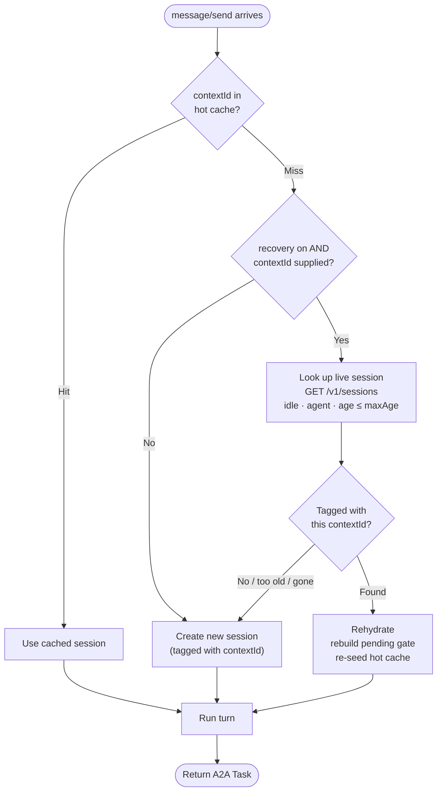

<p align="center">
  
</p>

# Claude A2A Bridge Policy

A MuleSoft Omni Gateway custom policy that bridges inbound **A2A protocol
`message/send`** requests to the **Anthropic Claude Managed Agents API**.
Built with the [Policy Development Kit (PDK)](https://docs.mulesoft.com/pdk/latest/policies-pdk-overview)
**1.10.0** as a standalone, split-model project.

## Use case

An A2A client sends a JSON-RPC `message/send` request to the gateway. This
policy terminates that request at the gateway and relays it to a Claude
managed agent: it creates (or reuses) a managed-agent session, submits the
caller's text as a `user.message` event, polls the session's event stream
until the turn completes, and maps the result back to a canonical A2A `Task`.

Key behaviors:

- **Session continuity.** Task and session state are kept in durable gateway
  storage so a multi-turn A2A conversation (`taskId` + `contextId`) resumes
  the same managed-agent session on the next call.
- **Agent card discovery.** A request to `/.well-known/agent-card.json` is
  served directly by the policy — either a pasted static card or one derived
  at request time from the managed agent's own configuration (name,
  description, skills, and MCP servers). The agent's system prompt is never
  exposed.
- **Tool confirmation.** Pending tool calls from the managed agent can be
  allowed, denied, or deferred back to the caller as
  `TASK_STATE_INPUT_REQUIRED`, based on ordered glob rules matched against a
  canonical tool key.

## Project layout

```
claude-a2a-bridge-policy/
├── claude-a2a-bridge-definition/   # GCL schema + Exchange metadata
│   ├── exchange.json
│   ├── gcl.yaml
│   └── Makefile
└── claude-a2a-bridge-flex/         # Rust implementation (compiles to wasm32-wasip1)
    ├── Cargo.toml
    ├── Makefile
    ├── docs/
    │   ├── spec.md                       # full protocol + lifecycle spec
    │   ├── agent-onboarding.md           # how to point the policy at a managed agent
    │   └── agent-card-asset-source.md    # paste vs. derive agent-card modes
    ├── src/
    │   ├── lib.rs             # entrypoint + filter wiring
    │   ├── contracts/         # Claude Managed Agents API DTOs (agent/message/session)
    │   ├── services/          # card_builder, claude_client, dispatcher, response_mapper, tool_gate
    │   ├── generated/         # config struct from gcl.yaml (hand-maintained)
    │   ├── errors.rs          # JSON-RPC error constructors
    │   ├── router.rs          # JSON-RPC request/response envelope handling
    │   ├── upstream.rs        # outbound Claude API service resolution
    │   ├── task_store.rs      # durable A2A task state (local/remote-replicated)
    │   ├── session_store.rs   # durable managed-agent session state
    │   ├── replica_registry.rs# multi-replica gossip registry (task_store dependency)
    │   ├── jsonrpc.rs         # minimal JSON-RPC 2.0 envelope types
    │   ├── a2a.rs             # inbound A2A `message/send` schema types
    │   ├── time.rs            # unix-seconds / ISO-8601 time helpers
    │   ├── access_log.rs      # structured access-log helpers
    │   └── util.rs            # agent-card path matching
    ├── playground/            # Docker-based local Omni Gateway for `make run`
    └── tests/                 # integration tests (pdk-test)
```

## Configuration

Configured via `claude-a2a-bridge-definition/gcl.yaml`. Key parameters:

| Parameter | Type | Default | Description |
|---|---|---|---|
| `agentId` | string | — (required) | Anthropic managed agent id (`agent_...`) |
| `environmentId` | string | — (required) | Managed-agent environment id (`env_...`) |
| `apiKey` | string (sensitive) | — (required) | Anthropic API key, sent as `x-api-key` |
| `agentCardSource` | enum `paste`\|`derive` | `paste` | Source of the served A2A agent card |
| `agentCard` | string | — | Static card JSON (or override when `derive`) |
| `cardDerivation.excludeMcpServers` | array\<string\> | — | Glob patterns of MCP servers to omit from a derived card |
| `anthropicVersion` | string | `2023-06-01` | `anthropic-version` header value |
| `betaHeader` | string | `managed-agents-2026-04-01` | `anthropic-beta` header value |
| `timeout` | integer (ms) | `60000` | Per-call timeout for a single Claude API request |
| `pollIntervalMs` | integer (ms) | `2000` | Delay between event-stream polls |
| `maxPollAttempts` | integer | `150` | Max polls before a turn is abandoned |
| `sessionTtlMinutes` | integer (min) | `60` | How long a paused `input-required` conversation stays resumable in gateway storage (clamped 1–1440); after it lapses a later reply starts a new turn |
| `sessionRecovery` | boolean | `false` | Resume a conversation whose hot-cache entry expired by finding its live Claude session by `contextId` (see [Session recovery](#session-recovery)) |
| `recoveryMaxAgeMinutes` | integer (min) | `1440` | When recovery is on, the oldest a session may be to be revived (clamped 1–43200) |
| `toolConfirmation.defaultAction` | enum `allow`\|`deny`\|`defer` | `defer` | Action for tools matching no rule |
| `toolConfirmation.logDecisions` | boolean | `false` | Log every tool-confirmation decision |
| `toolConfirmation.rules` | array\<object\> | — | Ordered glob rules (`tool`, `action`, `message`, `prompt`) |

See `claude-a2a-bridge-flex/docs/spec.md` for the full protocol coverage and
task lifecycle, and `claude-a2a-bridge-flex/docs/agent-card-asset-source.md`
for the paste vs. derive agent-card modes.

### Session recovery

`sessionTtlMinutes` keeps a conversation's `contextId → session` mapping in gateway
storage so follow-up turns are fast. That mapping is a **performance cache**; when it
expires, a follow-up (including a late reply to a paused `input-required` approval)
would normally start a brand-new session and lose the thread. But the **managed-agent
session itself persists on Claude's side** until deleted — it's only the gateway's
handle that's gone.



With `sessionRecovery` enabled, the bridge re-establishes that handle instead of
starting over:

1. **Tag at create** (always on, no cost) — every session is stamped with its A2A
   `contextId`/`taskId` in the managed-agent session `metadata`.
2. **On a hot-cache miss** for a *supplied* `contextId`, the bridge lists the agent's
   **idle** sessions created within `recoveryMaxAgeMinutes`, newest first, and matches
   the `contextId` in their metadata.
3. If found, it re-reads that session's events, **reconstructs the pending approval**
   from the trailing `requires_action`, and resumes — so a human approve/deny that
   arrives after the cache expired still lands on the right gate.

**When to enable it:** long or asynchronous human-approval windows (an approver who may
respond hours later or overnight), or added resilience when gateway storage is lossy
(multi-replica gossip). Leave it **off** (the default) for high-churn, short-lived
conversations that don't need approval windows beyond `sessionTtlMinutes`.

**Cost:** one lightweight `GET /v1/sessions` call (~¼–½ s) on the **first turn of a
conversation whose `contextId` isn't cached** — once per conversation, not per message.
It is **skipped entirely** when the caller omits `contextId` (a missing `contextId` is
unambiguously a new conversation). There is **zero overhead when `sessionRecovery` is
off.**

**Fail-safe:** if no session matches, the match is older than `recoveryMaxAgeMinutes`,
or the live session is gone, recovery quietly falls back to starting a fresh session —
it never resurrects the wrong conversation.

## Build & test

From `claude-a2a-bridge-flex/`:

```
make setup          # install cargo-anypoint
make build-asset-files
make build          # compiles to wasm32-wasip1 and packages the policy
make test-unit      # cargo test --lib (no Docker required)
make test           # unit + Docker-based integration tests
make run            # local Omni Gateway playground via Docker Compose
```

From `claude-a2a-bridge-definition/`:

```
make build          # build the GCL policy definition
```

## Security considerations

Deploy the policy with these operational properties in mind:

- **Cost / denial-of-service bounding.** Every accepted `message/send` drives a
  Claude managed-agent turn (session create/reuse plus up to `maxPollAttempts`
  event-stream polls) and consumes Anthropic API quota and spend. The policy
  does not itself rate-limit or cap concurrent turns. Front it with a
  rate-limiting / spike-control policy, and tune `timeout`, `maxPollAttempts`,
  and `pollIntervalMs` to bound worst-case latency and per-request cost.
- **Derived agent-card URL reflects the request `Host`.** In
  `agentCardSource: derive` mode the served card's URL is built from the
  inbound request's `Host` header, so a caller that supplies an
  attacker-controlled `Host` can influence the advertised URL. Front the
  gateway with a trusted router that sets or validates `Host`, or use `paste`
  mode with an explicit card when the advertised URL must be fixed.
- **HITL tool-confirmation trusts an inbound user identity.** Deferred tool
  confirmations correlate the human decision to the caller via the
  `x-anypoint-user-id` request header, which is trusted as supplied. Ensure an
  upstream authentication policy sets that header (and strips any
  client-supplied value) so a caller cannot act on another user's behalf.
- **API key handling.** `apiKey` is marked `security:sensitive` in the GCL
  schema so the platform masks it; prefer a Flex secret reference over an
  inline literal. The key is sent only to the configured Anthropic upstream as
  the `x-api-key` header and is not written to logs.

## Caveats

- **Streaming is out of scope.** The policy issues one Claude turn per A2A
  `message/send` and polls to completion; `message/stream` and other
  streaming A2A methods are not implemented.
- **`src/generated/config.rs` is hand-maintained**, not generated by
  `cargo anypoint config-gen`, because the GCL schema uses nested-object
  properties the generator does not yet prettify. Do not regenerate over it.
- Requires a Claude managed agent already provisioned in the target
  Anthropic environment; this policy does not create or manage agents.
